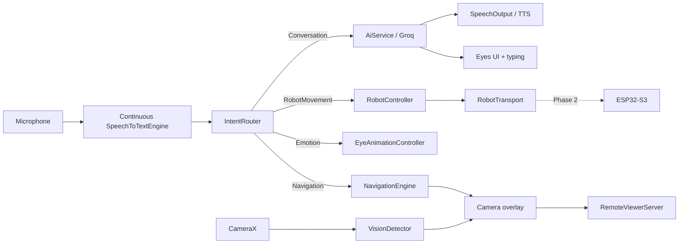
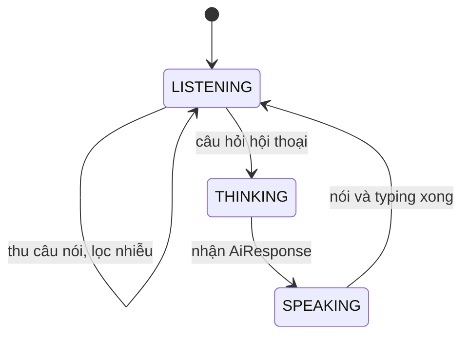
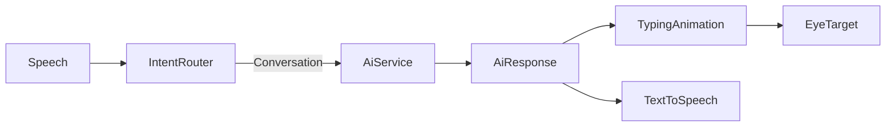
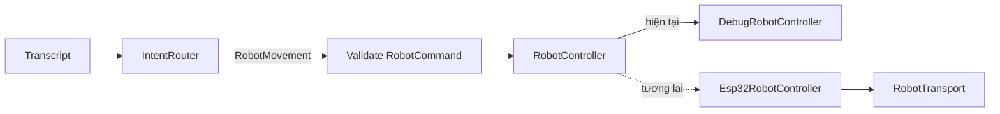
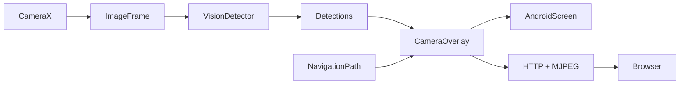
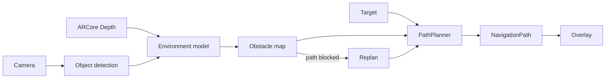

# ONE Robot Assistant

ONE là ứng dụng Android đóng vai trò **bộ não của robot**. Điện thoại chịu trách nhiệm cho camera, microphone, hội thoại AI, khuôn mặt robot, phân loại lệnh và về sau là navigation. ESP32-S3 chỉ là bộ điều khiển phần cứng; trình duyệt trên laptop/điện thoại khác chỉ là remote viewer trong LAN.

> Trạng thái hiện tại: **MVP STEP 1–9 đã được tích hợp**. App có Eyes Mode, Camera Mode, mic liên tục, Groq text + vision với offline fallback, TTS + typing, local intent, DebugRobotController, MediaPipe object detection và HTTP/MJPEG viewer trong LAN. STEP 10 vẫn là skeleton vì ARCore navigation và ESP32 thật thuộc phase 2.

## Nguyên tắc hệ thống

```text
PHONE   = BRAIN
ESP32   = BODY CONTROLLER
BROWSER = REMOTE VIEWER
```

- Không dùng laptop làm server xử lý trung tâm.
- UI không gọi trực tiếp Groq hoặc ESP32.
- Lệnh rõ ràng được xử lý local; không gửi mọi câu nói tới LLM.
- Mọi tích hợp có interface để thay implementation mà không sửa UI.
- `RobotCommand` phải được validate trước khi tới transport.
- Không hardcode Groq key hoặc địa chỉ ESP32.

## Kiến trúc



`AssistantViewModel` giữ state dùng chung cho UI. Các feature giao tiếp qua model/interface; Activity chỉ gắn Compose root.

## Data flow

### Mic liên tục và hội thoại





Mic tự bật sau khi người dùng cấp quyền. Android `SpeechRecognizer` lọc tiếng nền, app loại các âm đệm ngắn và gửi câu nói sau khoảng hai giây im lặng; không còn wake word.

### Robot command



Direct movement (`tiến`, `lùi`, `trái`, `phải`, `xoay`, `dừng`) không kích hoạt navigation. Target navigation (`tiến lại gần tôi`, `chạy tới đây`) mới tạo path.

### Camera và remote viewer



`ImageFrame`, `Detection` và bounding box không phụ thuộc vào implementation detector. MediaPipe, YOLO hoặc fake detector có thể cùng tuân theo `VisionDetector`.

### Navigation tương lai



ARCore Depth, obstacle mapping và autonomous navigation đều được đánh dấu `TODO(PHASE_2)`; skeleton hiện tại không giả vờ là implementation production.

## Cấu trúc source

```text
app/src/main/java/com/one/robotassistant/
├── MainActivity.kt
├── OneApplication.kt
├── core/
│   ├── debug/             DebugState chung
│   ├── model/             OneState
│   ├── network/           cấu hình API
│   └── util/              logging
├── feature/
│   ├── assistant/
│   │   ├── ai/            GroqAiService + FakeAiService
│   │   ├── intent/        local Vietnamese IntentRouter
│   │   ├── speech/        Android SpeechRecognizer + TTS
│   │   └── speech/        continuous STT + TTS
│   ├── camera/             CameraX screen + frame pipeline
│   │   ├── detection/     MediaPipe/EfficientDet + contracts
│   │   └── overlay/       bounding-box state
│   ├── eyes/              EyesScreen + EyesViewModel
│   │   ├── animation/     controller + default implementation
│   │   └── model/         EyeState, EyeExpression, EyeTarget
│   ├── robot/
│   │   ├── command/       validated RobotCommandRequest
│   │   ├── controller/    DebugRobotController
│   │   └── transport/     ESP32 transport boundary + fake
│   ├── navigation/
│   │   ├── depth/         DepthProvider
│   │   ├── model/         target/path/environment
│   │   ├── overlay/       navigation overlay model
│   │   └── planner/       PathPlanner
│   └── remoteviewer/
│       ├── server/        HTTP/MJPEG server + frame publisher
│       └── web/           browser endpoints
└── ui/
    ├── navigation/        Compose root/destinations
    └── theme/             black/white ONE theme
```

Tên implementation fake/debug được giữ rõ ràng để không bị nhầm với ESP32, depth hoặc navigation production trong phase 2.

## Dependencies runtime

- Kotlin + Jetpack Compose + Material 3.
- Lifecycle/ViewModel + Coroutines/Flow.
- CameraX contracts (`camera2`, `lifecycle`, `view`).
- OkHttp gọi Groq Chat Completions API.
- MediaPipe Tasks Vision 1.0.0 + EfficientDet-Lite0 nhận diện object/person on-device.
- JUnit + Coroutines Test.

Model nằm tại `app/src/main/assets/efficientdet_lite0.tflite`. ARCore chưa được thêm vào binary vì navigation tự hành là phase 2; các interface depth/path đã có sẵn.

## Cấu hình `GROQ_API_KEY`

Không đặt API key trong Kotlin source hoặc commit key lên Git.

1. Mở file `local.properties` tại project root (Android Studio thường đã tạo `sdk.dir`).
2. Thêm dòng:

   ```properties
   GROQ_API_KEY=your_real_groq_api_key
   ```

3. Sync/build lại project. Gradle đưa giá trị vào `BuildConfig.GROQ_API_KEY`.

`local.properties.example` chỉ là mẫu. `local.properties` đã nằm trong `.gitignore`.

Có thể thêm `GROQ_MODEL`; mặc định là `llama-3.3-70b-versatile`. Câu hỏi camera dùng `GROQ_VISION_MODEL`, mặc định `qwen/qwen3.8-27b`.

Nếu không có key hoặc Groq gặp lỗi mạng, app tự dùng `FakeAiService`. Với bản phân phối thực tế, API key trong APK vẫn có thể bị trích xuất; nên dùng key giới hạn quyền/quota và xoay key định kỳ.

## Chạy project

Yêu cầu:

- Android Studio có Android SDK 37.
- JDK đi kèm Android Studio.
- Thiết bị/emulator Android 8.0 (API 26) trở lên.

Windows:

```powershell
cd D:\Dinh\OneAi\application
.\gradlew.bat :app:assembleDebug
.\gradlew.bat :app:testDebugUnitTest
```

Sau đó mở project bằng Android Studio, chọn thiết bị và Run `app`.

## Cách sử dụng MVP

1. Cấp quyền microphone khi app mở; mic sẽ tự nghe liên tục, không cần nói wake word.
2. Nói câu hỏi hoặc lệnh bình thường. Sau khoảng hai giây im lặng, Linh tự xử lý và trả lời.
3. Bấm `CAMERA`, cấp quyền camera để mở preview + object detection.
4. Trong Camera Mode, địa chỉ `LAN: http://...:8080` xuất hiện ở debug overlay. Mở địa chỉ đó từ browser cùng mạng Wi-Fi để xem MJPEG + trạng thái debug.
5. Bấm `EYES` để trở lại khuôn mặt robot.

Khi Camera Mode đang chạy, câu `Đây là cái gì?` chụp frame camera gần nhất và gửi ảnh thật cùng nhãn MediaPipe tới Groq Vision.

Lệnh local gồm biểu cảm (`vui lên`, `buồn đi`, `thắc mắc`, `chóng mặt`, `bình thường lại`), movement (`tiến`, `lùi`, `rẽ trái`, `rẽ phải`, `xoay`, `dừng`) và target navigation (`tiến lại gần tôi`, `chạy tới đây`). Các câu còn lại mới được gửi tới AI.

## Debug Mode

Model `DebugState` gom các trạng thái mic, speech, intent, robot, AI, eyes, camera, detector, navigation và ESP32. Trong Eyes Mode, chạm màn hình để hiện tạm các điều khiển, rồi nhấn `•••` để thử `NORMAL`, `HAPPY`, `SAD`, `CONFUSED`, `DIZZY`.

- Debug build: overlay có thể được bật mặc định hoặc bằng developer control.
- Release build: overlay phải tắt mặc định.
- Log dùng prefix dễ lọc: `ONE/WAKE`, `ONE/STT`, `ONE/INTENT`, `ONE/ROBOT`, `ONE/TTS`, `ONE/EYES`, `ONE/NAV`.

## ESP32-S3 future integration

UI và intent router chỉ biết `RobotController`. Implementation ESP32 về sau dùng `RobotTransport` (Wi-Fi hoặc Bluetooth) và không làm thay đổi màn hình/AI.

Protocol dự kiến:

```json
{"type":"MOVE","action":"FORWARD","speed":0.5}
```

```json
{"type":"STOP"}
```

Transport production cần framing, timeout, acknowledgement, reconnect và emergency stop. IP/địa chỉ thiết bị phải đến từ settings hoặc discovery, không hardcode.

## Lộ trình triển khai

1. **STEP 1 — hoàn tất:** skeleton, dependencies, models, interfaces, diagrams.
2. **STEP 2 — hoàn tất:** Eyes Mode fullscreen, clock, blink/pupil animation, expression và debug controls.
3. **STEP 3 — hoàn tất:** Camera Mode fullscreen, permission và CameraX preview.
4. **STEP 4 — hoàn tất:** Speech-to-text liên tục + gom câu theo khoảng im lặng.
5. **STEP 5 — hoàn tất:** Groq conversation + offline fallback + TTS/typing/eye tracking.
6. **STEP 6 — hoàn tất:** local IntentRouter.
7. **STEP 7 — hoàn tất:** DebugRobotController và voice feedback.
8. **STEP 8 — hoàn tất:** MediaPipe/EfficientDet object detection + bounding boxes.
9. **STEP 9 — hoàn tất:** LAN HTTP/MJPEG remote viewer.
10. **STEP 10 — skeleton:** ARCore depth, autonomous path planning, ESP32 transport thật và WebRTC.

Mỗi step phải build, test và về trạng thái commit-ready trước khi chuyển tiếp.
